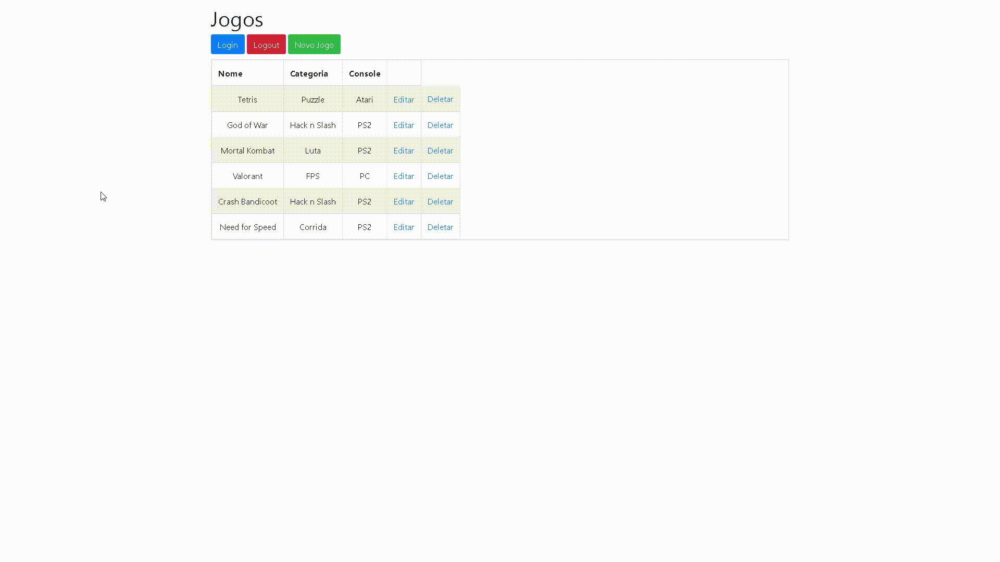

<h1 align="center" style="font-weight: bold;">Jogoteca</h1>

<p align="center">
  
</p>

[PYTHON__BADGE]: https://img.shields.io/badge/Python-3776AB?style=for-the-badge&logo=python&logoColor=white
[FLASK__BADGE]: https://img.shields.io/badge/Flask-000000?style=for-the-badge&logo=flask&logoColor=white
[MYSQL__BADGE]: https://img.shields.io/badge/MySQL-4479A1?style=for-the-badge&logo=mysql&logoColor=white
[BOOTSTRAP__BADGE]: https://img.shields.io/badge/Bootstrap-563D7C?style=for-the-badge&logo=bootstrap&logoColor=white

<p align="center">
  <a href="#tech">Tecnologias</a> •
  <a href="#database">Banco de Dados</a> •
  <a href="#started">Iniciando</a> •
  <a href="#features">Funcionalidades</a> •
  <a href="#acesso">Acesso</a> •
  <a href="#colab">Colaboradores</a>
</p>

<p align="center">
  <b>Aplicação web desenvolvida em Flask para gerenciamento de catálogo de jogos, com sistema de autenticação segura, controle de sessões, ORM e upload de capas.</b>
</p>

<h2 id="layout">🎨 Preview</h2>

<p align="center">
    
</p>

<h2 id="tech">💻 Tecnologias</h2>

<div>

![Python][PYTHON__BADGE]
![Flask][FLASK__BADGE]
![MySQL][MYSQL__BADGE]
![Bootstrap][BOOTSTRAP__BADGE]

</div>

<h2 id="database">⚠️ Requisito Crítico: Banco de Dados MySQL</h2>

> **Atenção:** Este projeto **exige obrigatoriamente o uso do MySQL** para gerenciar os dados relacionais de jogos e usuários. Sem o servidor MySQL rodando e configurado, a aplicação não funcionará.
>
> **Recomendação:** Recomendamos fortemente o uso do **[XAMPP](https://www.apachefriends.org/pt_br/index.html)** para gerenciar o servidor MySQL local de forma simples e rápida no Windows. Certifique-se de iniciar o serviço do **MySQL** no painel do XAMPP antes de rodar o projeto.

<h2 id="started">🚀 Iniciando</h2>

Siga os passos abaixo para configurar e rodar o projeto em sua máquina local.

<h3>Pré-requisitos</h3>

- [Python](https://www.python.org/) (Versão 3.8 a 3.10 recomendada)
- [Git](https://git-scm.com/)
- [XAMPP](https://www.apachefriends.org/) (com o serviço MySQL ativo)

<h3>Clonando o Repositório</h3>

```bash
git clone https://github.com/JoaoxVictorMS/Jogoteca.git
cd Jogoteca
```

<h3>Configurando o Ambiente Virtual</h3>

Crie e ative o ambiente virtual para isolar as dependências do projeto:

```bash
# Criando o ambiente virtual
python -m venv .venv

# Ativando no Windows (PowerShell)
.venv\Scripts\Activate.ps1

# Ativando no Linux / macOS
source .venv/bin/activate
```

<h3>Instalando as Dependências</h3>

Com o ambiente virtual ativo, instale os pacotes necessários:

```bash
pip install -r requirements.txt
```

<h3>Preparando o Banco de Dados</h3>

Certifique-se de que o seu servidor MySQL está rodando (via XAMPP). Em seguida, execute o script de inicialização para criar o banco de dados `jogoteca`, estruturar as tabelas e inserir os dados iniciais:

```bash
python prepara_banco.py
```

<h3>Executando o Servidor de Desenvolvimento</h3>

```bash
python jogoteca.py
```

Acesse o projeto no navegador através do endereço exibido no terminal (geralmente `http://127.0.0.1:5000/` ou `http://127.0.0.1:8000/`).

<h2 id="features">⚙️ Funcionalidades</h2>

- **Autenticação Segura**: Sistema de login e controle de sessões protegido por criptografia de senhas (`Flask-Bcrypt`).
- **Proteção CSRF**: Segurança integrada contra ataques Cross-Site Request Forgery utilizando `Flask-WTF`.
- **CRUD Completo de Jogos**: Adição, listagem, edição e remoção de registros vinculados ao banco via SQLAlchemy.
- **Upload de Capas**: Gerenciamento de imagens personalizadas para cada jogo com tratamento de nomes únicos por timestamp.
- **Controle de Acesso**: Rotas protegidas que exigem login prévio para cadastrar, editar ou excluir jogos.

<h2 id="acesso">🔑 Usuários de Teste (Padrão)</h2>

Você pode utilizar o usuário administrador principal ou as contas padrão criadas pelo script de preparação do banco:

- **Administrador:** Nickname: `admin` | Senha: `admin`
- **Usuário 1:** Nickname: `BD` | Senha: `alohomora`
- **Usuário 2:** Nickname: `Mila` | Senha: `paozinho`
- **Usuário 3:** Nickname: `Cake` | Senha: `python_eh_vida`

<h2 id="colab">🤝 Colaboradores</h2>

<table>
  <tr>
    <td align="center">
      <a href="https://github.com/JoaoxVictorMS">
        <br>
        <sub>
          <b>João Victor</b>
        </sub>
      </a>
    </td>
  </tr>
</table>

<h2 id="contribute">📫 Contribua</h2>

Contribuições são sempre bem-vindas! Se você tiver sugestões de melhorias ou correções, siga os passos abaixo:

1. Faça um **Fork** do projeto (`git clone https://github.com/JoaoxVictorMS/Jogoteca.git`)
2. Crie uma branch para sua feature ou correção (`git checkout -b feature/MinhaMelhoria`)
3. Faça o commit das suas alterações (`git commit -m 'Adiciona nova melhoria'`)
4. Faça o push para a branch (`git push origin feature/MinhaMelhoria`)
5. Abra um **Pull Request** detalhando suas alterações

<h3>Documentações que podem ajudar</h3>

- [📝 Como criar um Pull Request](https://www.atlassian.com/br/git/tutorials/making-a-pull-request)
- [💾 Padrão de Commits](https://iuricode.com/padroes-de-commits/)
